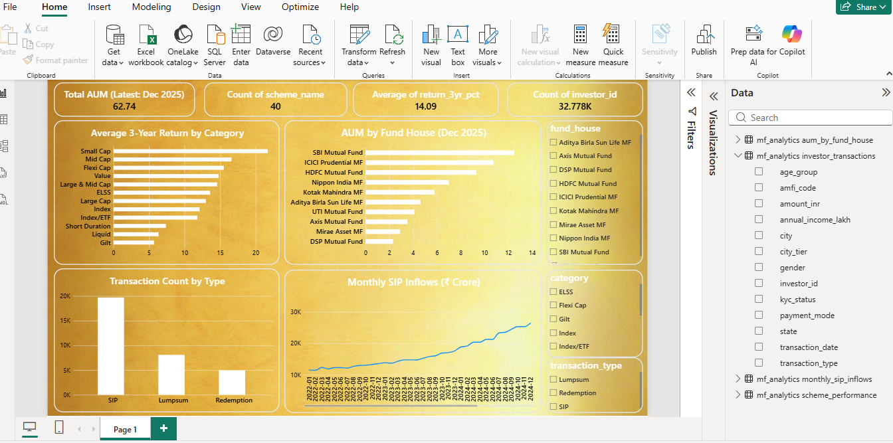

## SQL Business Analysis

SQL business analysis was performed using MySQL on the mutual fund analytics database.

### Key Analysis Areas
- Top mutual fund schemes ranked by 3-year returns
- Category-wise average mutual fund returns
- Fund house AUM comparison and ranking
- Monthly SIP inflow trends
- Investor transaction analysis by transaction type
- State-wise investor transaction analysis
- Age-group and payment-mode analysis
- KYC status analysis
- Risk and return comparison using beta and Sharpe ratio
- Mutual fund returns compared with benchmark returns
- Expense ratio and fund performance comparison
- Fund house and category-wise performance comparison

## Power BI Dashboard Preview

### Power BI Dashboard File

[View or download the Power BI Dashboard](dashboard/MF_Analytics_Dashboard.pbix)

### Tools Used
- MySQL
- MySQL Workbench
- SQL aggregation, filtering, sorting, grouping, and subqueries

### SQL File
See [`business_analysis.sql`](sql/business_analysis.sql) for the SQL queries used in this analysis.
